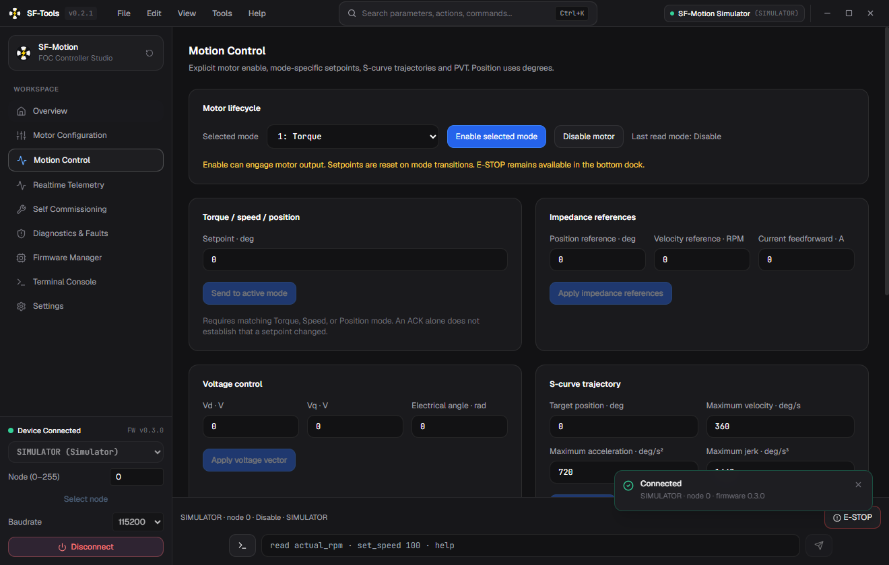

# SF-Tools

Desktop configuration, commissioning, motion control, and telemetry for **SF-Motion** motor controllers.

**Application:** 0.2.1 · **Firmware:** 0.3.0 · **Platform:** Windows x64



SF-Tools connects to an SF-Motion controller over USB serial, including node selection through the firmware USB-to-CAN bridge. An explicit simulator provides the same register protocol for exploring the application without hardware.

- Configure motor, FOC, PID, encoder, impedance, trajectory, and protection parameters.
- Apply changes with readback verification, save to flash, and manage configuration profiles.
- Control torque, speed, position, impedance, and voltage with explicit motor enable.
- Create S-curve moves and PVT profiles; import and export motion points as CSV.
- Commission resistance, inductance, encoder, pole pairs, and cogging compensation.
- Plot telemetry, export CSV, and inspect device events and actual transport packets.

## Install and run

Use the **Windows installer** from this repository's GitHub Releases when available. It installs SF-Tools and checks for Microsoft Edge WebView2 Runtime, downloading the runtime if needed. Internet access is required for that download.

The **portable EXE** can be copied directly to the Desktop or another folder. It packages its loader internally; no `WebView2Loader.dll` or companion folder is needed beside the EXE. WebView2 Runtime must already be installed when using the portable version.

Select your COM port and node (default **0**), or choose **SIMULATOR** explicitly. A connection error never silently switches to the simulator. One node is active at a time.

See [Getting started](docs/getting-started.md) for the configuration and motor-control workflow.

## Compatibility

This release targets [SF-Motion 0.3.0, commit 2e58c941](https://github.com/sirojudinMunir/sf-motion/commit/2e58c941620b2fbd82c751d390fcecee27f16ece). Older firmware protocols are not supported.

The [firmware feature matrix and limitations](docs/firmware-compatibility.md) document the exact supported behavior, including staged settings, PVT buffer semantics, and commissioning events. Firmware Manager provides version information and ST-Link/PlatformIO guidance.

## Develop

Prerequisites: Node.js 22+, npm, Rust with rustfmt, a Windows toolchain, and WebView2 Runtime. The Windows packaging pipeline currently uses the GNU target and MinGW.

```powershell
npm ci
cargo fetch --locked --manifest-path src-tauri/Cargo.toml
npm run check
npm run prepare:runtime
npm run tauri dev
```

Build the Windows installer and portable EXE:

```powershell
npm run build:windows
```

Outputs are generated in `artifacts/windows/` and excluded from Git. Publish release binaries through GitHub Releases.

## Documentation

- [Getting started](docs/getting-started.md)
- [Development and repository layout](docs/development.md)
- [Architecture](docs/architecture.md)
- [Firmware compatibility](docs/firmware-compatibility.md)
- [Release process and validation](docs/releasing.md)
- [Changelog](CHANGELOG.md)
- [Contributing](CONTRIBUTING.md)

## License

An application license has not yet been selected. No application license is added by this release. The vendored SF-Motion reference files retain their [upstream MIT license](shared/firmware/LICENSE). See [third-party notices](THIRD_PARTY_NOTICES.md).
